# METCOM Python 版 图形界面说明文档

> 汇报稿 · 版本 v3.1.0（Python 迁移版） · 整理日期 2026-09-22
> 配套截图目录：`docs/gui-shots/`（25 张，2× 高清渲染，可直接拖入 PPT）

---

## 1. 文档范围与结论速览

本文档说明 METCOM Python 版图形界面（GUI）的建设目标、界面结构、视觉规范、
功能清单与实测结果，并如实列出当前环境下仍未打通的环节。

三条结论：

1. **界面已完成并可正常运行**：启动画面、自绘窗口外壳、8 个功能页面、深浅双主题、
   可折叠日志抽屉全部可用；本轮交互实测 24 项步骤零异常。
2. **以图形化展示为核心**：可视化工作台提供 5 种视图（叠加曲线 / 分面小倍数 /
   指标对比表 / 雷达图 / 站点地图），打开即渲染仓库内基准数据——5 个数据源、
   1443 个测站、48 个时次，无需先跑流程。
3. **真实业务链路（01→05）目前无法在本机直接跑通**：原因是外部数据与凭据缺失
   （原 MATLAB 包目录、E 盘再分析数据、EGM2008 文件、CDS API 密钥），
   属于数据环境准备问题，不是界面缺陷。清单见第 10 节。

整体观感（深色主题工作台首页）：

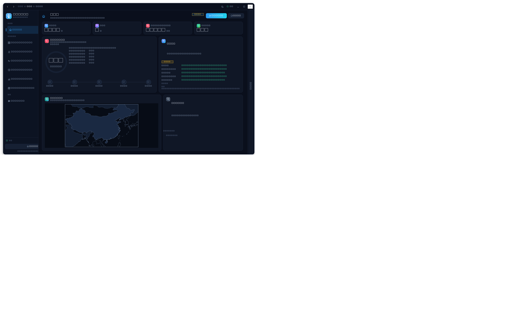

---

## 2. 建设背景

| 版本 | 交付形态 | 使用方式 |
| --- | --- | --- |
| 原 MATLAB 版 | 5 个独立 App Designer 界面（`.mlapp`） | 每个模块单独打开、单独填参数 |
| Python 迁移版（本次之前） | 配置文件 + 命令行 | 改 YAML、敲命令、看终端输出 |
| Python 迁移版（本次之后） | 一站式桌面图形界面 | 导航切页 → 填参数 → 点运行 → 直接看图 |

本次工作是在**不改动任何业务算法代码**的前提下，补上一层完整的桌面交互外壳，
把原先分散在命令行里的参数、日志与结果，收进一个以图形化展示为中心的工作台。

---

## 3. 总体架构

界面代码集中在 `metcom/gui/`，与业务代码严格分层：

| 层次 | 文件 | 职责 |
| --- | --- | --- |
| 外壳 | `app.py`、`window.py` | 启动画面、无边框主窗口、标题栏、页面堆栈、日志抽屉 |
| 导航 | `components/sidebar.py`、`state.py` | 分组侧边导航、模块表、工作流进度、运行历史 |
| 页面 | `pages/*.py`（8 个） | 每个功能一页，统一继承 `BasePage` |
| 通用控件 | `components/*.py` | 卡片、统计块、流程条、日志台、表单行、路径选择器 |
| 图表 | `charts.py`、`charts_map.py` | 曲线、分面、雷达、热度表、时间轴、进度环、地图 |
| 设计系统 | `theme.py`、`icons.py` | 配色令牌、字体、样式表、矢量图标与徽章 |
| 数据接入 | `data.py`、`tasks.py`、`workers.py` | 结果目录扫描、参数校验、后台线程与日志捕获 |

**业务代码零改动**：界面把页面采集到的参数字典交给既有的 `metcom` 业务函数执行，
日志仍走原有的 stdout/logging，由 `workers.py` 重定向捕获后显示到抽屉里；
`metcom/` 下除 `gui/` 之外的任何模块，本次未作修改。

---

## 4. 视觉设计体系

### 4.1 图标：运行时矢量 + 双色调渐变徽章

- 全部图标是内置的矢量路径，**运行时按需着色渲染**，不依赖位图素材，
  因此在 2× 乃至 4× 高 DPI 下依旧锐利，不会出现模糊或锯齿。
- 徽章由两部分组成：圆角底板走**双色调线性渐变**（主色 → 副色），
  上面叠一个白色线性图标。渐变方向、圆角半径与投影按尺寸等比缩放。
- 图标按语义分组配色（如流程步骤、系统设置、数据源各成一套色调），
  同一页里不同含义的图标自带区分度，不靠文字标签也能扫读。

### 4.2 五源色彩与专属徽章

每个数据源一个固定的徽章图形与固定色值，**任何图表里同一数据源永远是同一个颜色**，
曲线、图例、地图、雷达图之间可以互相印证：

| 数据源 | 徽章图形 | 深色主题 | 浅色主题 |
| --- | --- | --- | --- |
| ERA5 | 地球 | `#38BDF8` | `#0284C7` |
| CMA-MESO | 雷达 | `#F472B6` | `#DB2777` |
| CRA40 | 数据库 | `#FBBF24` | `#B45309` |
| CRA V1.5 | 图层 | `#34D399` | `#047857` |
| MERRA2 | 卫星 | `#A78BFA` | `#6D28D9` |

### 4.3 颜色令牌与双主题

界面所有颜色都取自 `theme.py` 的令牌表，不散落在各处写死，换主题等于换一张表：

| 令牌 | 深色「深空」 | 浅色「晨曦」 | 用途 |
| --- | --- | --- | --- |
| `bg` | `#0A0F1C` | `#F2F5FA` | 窗口底色 |
| `sidebar` | `#0C1322` | `#FFFFFF` | 侧边导航 |
| `surface` | `#101726` | `#FFFFFF` | 卡片 |
| `border` | `#1E2A40` | `#E1E8F2` | 分隔线 |
| `text` / `text_muted` | `#E8EEF9` / `#8FA3C0` | `#0E1A2B` / `#5B6E88` | 正文 / 次要文字 |
| `accent` → `accent_alt` | `#2E9BF0` → `#22D3EE` | `#1478D4` → `#0891B2` | 强调色渐变（选中态、徽章底） |
| `success` / `warning` / `danger` | `#34D399` / `#FBBF24` / `#F87171` | `#16A34A` / `#D97706` / `#DC2626` | 状态色 |
| `plot_bg` | `#070C16` | `#FFFFFF` | 图形画布底色 |

同一页面的浅色版本：

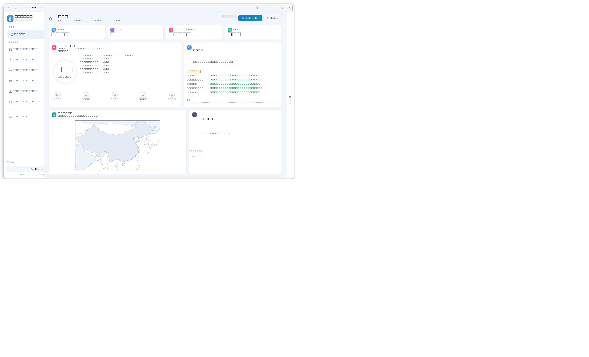

### 4.4 字体与数值排版

- 界面字体按可用性自动选择，优先使用系统中文字体族，缺失时按候选表逐级回退。
- 数值、路径、日期等对齐全靠等宽字体（`mono_font`），避免数字跳动。
- 关键数值走大字号 + 粗字重，次要说明走 `text_muted`，形成清晰的三级信息层次。

### 4.5 图形配色随主题联动

图形画布不写死白色底：地图的海面、陆地、省界、站点描边等颜色，
都由当前主题的画布底色推导而来。切换主题后，图形区域与界面同步换肤，不会出现
「深色界面里插了一张白底图」的割裂感。

---

## 5. 窗口外壳

### 5.1 启动画面

启动时显示一张独立设计的启动画面，含渐变徽章 Logo、平台名称与副标题，
并按三个阶段给出文字进度：**环境自检 → 加载页面 → 就绪**，
完成后与新窗口做 400 ms 交叉淡入淡出，不出现闪白或跳变。

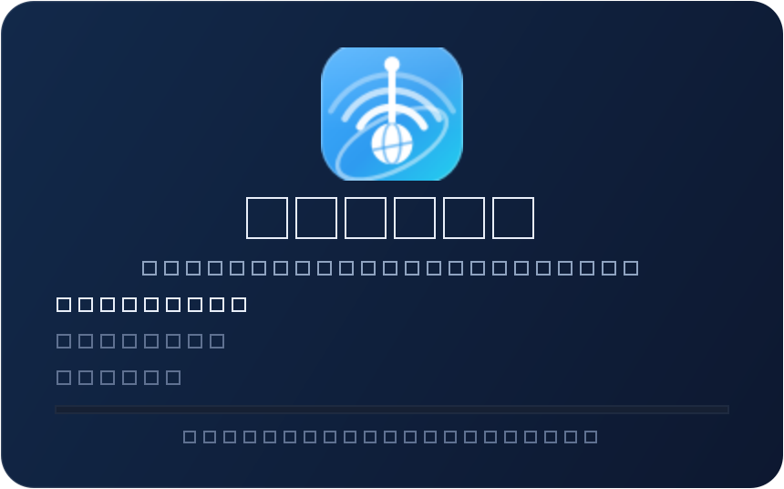

### 5.2 自绘标题栏

窗口不采用系统默认边框，改为自绘标题栏，高 46 px，内容自左至右为：

- 品牌徽章 + 平台名；
- 当前页面面包屑（分组 › 页面 › 子视图）；
- 前进 / 后退按钮（按浏览历史启用或置灰）；
- 任务忙碌指示（后台运行时显示动画点，附带任务名）；
- 主题一键切换按钮；
- 最小化 / 最大化-还原 / 关闭三个窗口按钮。

### 5.3 拖动与缩放

- 拖动：走系统原生窗口移动流程，手感与系统窗口一致，不做自绘位移，因此不抖动、不跟丢。
- 缩放：鼠标移到四边或四角时切换为对应方向的缩放光标，按下即进入系统原生八向缩放；
  窗口四周留有透明外边距与阴影。
- 最大化时自动去掉圆角、阴影与外边距，与屏幕边框贴合；
  还原后恢复圆角与阴影。
- 侧边导航放在滚动区内，窗口压矮时导航滚动而非被截断，窗口最小高度不再被导航撑住。

### 5.4 运行日志抽屉

原先占据底部的日志区改为**可折叠的右侧抽屉**，收起时只留一个竖排「运行日志」标签，
不占用图形区空间；展开后包含：

- 全量日志（保留最近 4000 行），按级别着色区分普通信息、警告与错误；
- 顶部标题栏有清空按钮与收起按钮；
- 底部进度条与进度文字，任务运行时实时更新。

展开态与最大化态：

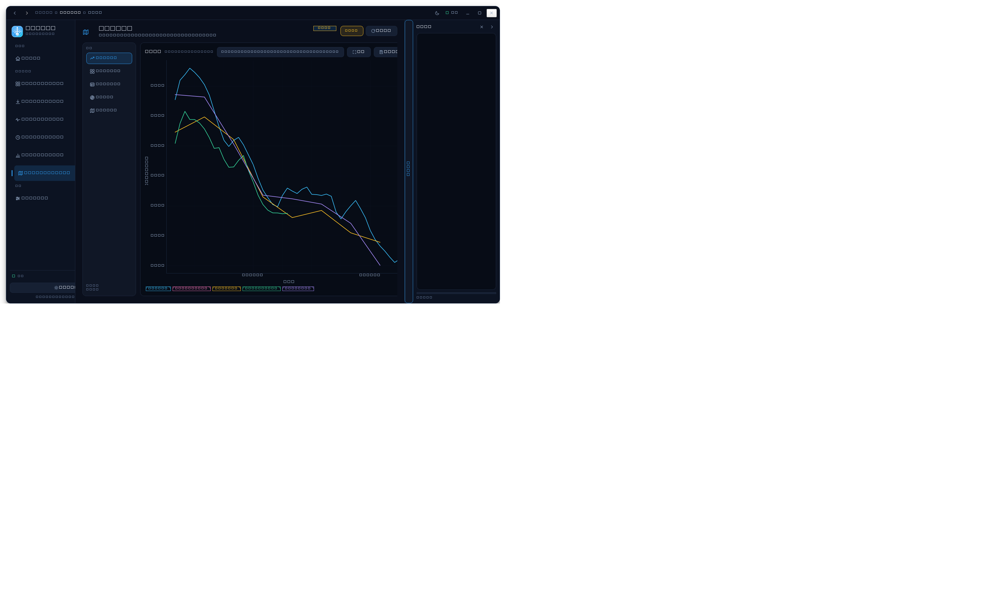

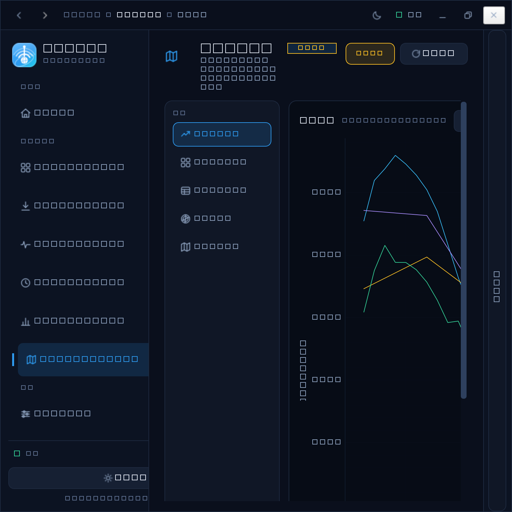

---

## 6. 页面清单

侧边导航分三组：**工作区 / 反演流水线 / 系统**，共 8 个页面。

| 页面 | 分组 | 主要功能 |
| --- | --- | --- |
| 工作台 | 工作区 | 四张指标卡（测站数量、数据源、最近 ZTD RMSE、完成步骤）、五步流水线进度环与一键执行、数据来源判定、站点空间分布小图、近期运行记录 |
| 01 · 格点生成 | 反演流水线 | DEM 区域裁剪 + 格点文本生成，输出格点清单 |
| 02 · 数据下载 | 反演流水线 | 按时间范围从 CDS 拉取 ERA5 资料，支持分目录与续传 |
| 03 · 核心反演 | 反演流水线 | 逐时次、逐站点反演 ZTD / ZHD / ZWD / PWV（平台核心算法） |
| 04 · 时间插值 | 反演流水线 | 把粗时间分辨率结果插值到目标分辨率（默认 6h → 1h） |
| 05 · 精度评估 | 反演流水线 | 与参考数据逐时 / 逐站对比，给出 Bias 与 RMSE，并预览结果表 |
| 05 · 可视化绘图 | 反演流水线 | 图形化工作台，五种视图，详见第 7 节 |
| 环境与设置 | 系统 | 依赖自检、工程路径、界面偏好、图表引擎状态 |

各页面统一结构：页头（图标 + 标题 + 一句话说明）+ 参数卡 + 运行按钮 + 结果区，
因此学会一页即会其余各页。

| 01 格点生成 | 03 核心反演 |
| --- | --- |
| 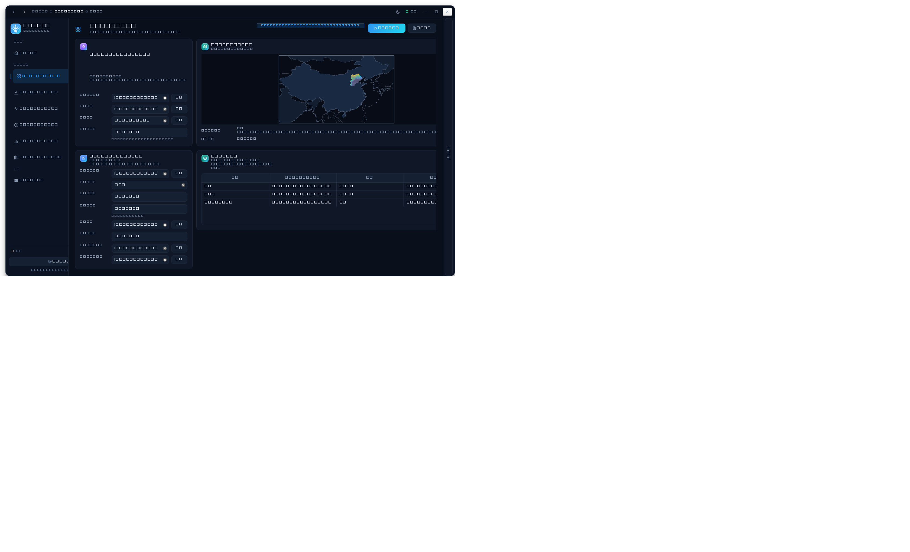 | 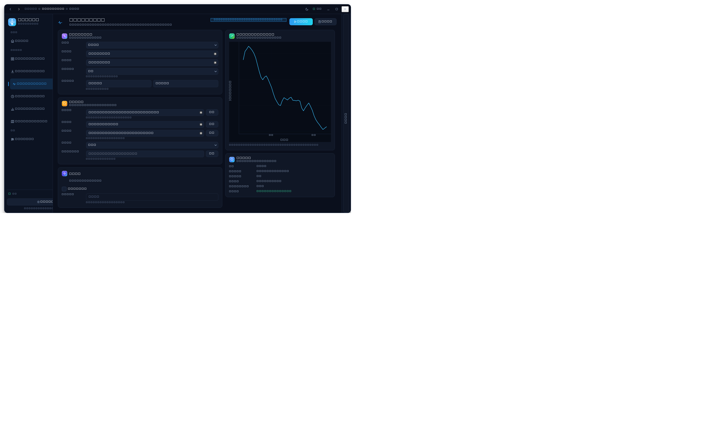 |

| 05 精度评估 | 环境与设置 |
| --- | --- |
| 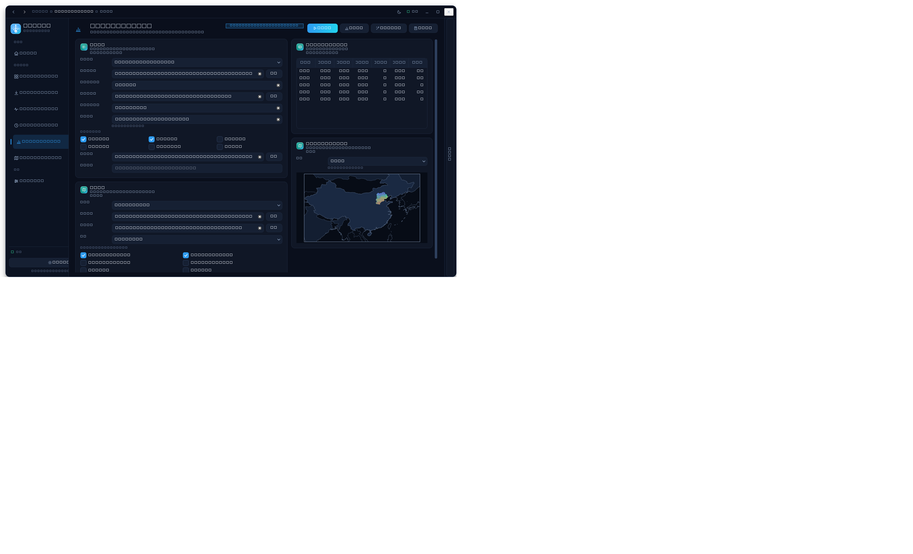 | 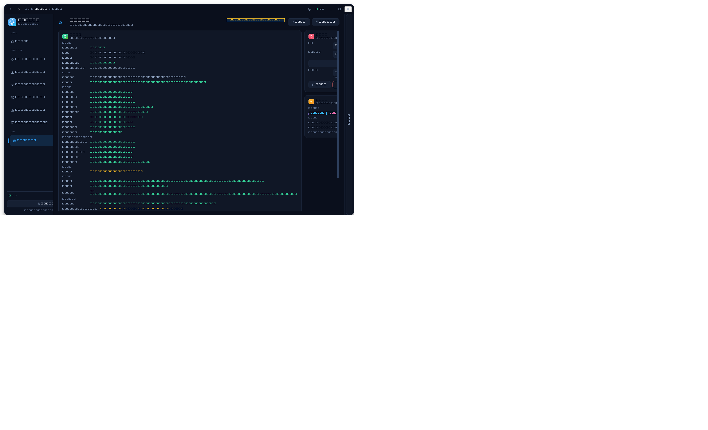 |

---

## 7. 可视化工作台（核心页）

页面为三栏布局：**左侧视图导航（180 px）/ 中间画布 / 右侧参数区**。
右上角有数据来源胶囊标签（演示数据 / 我的结果）与「重新扫描」按钮。


### 7.1 五种视图

| 视图 | 图形 | 说明 |
| --- | --- | --- |
| 叠加曲线 | 折线 + 悬停游标 | 五源同图叠加，比较时间序列趋势与源间分离度 |
| 分面小倍数 | 网格子图 | 行 = 数据源，列 = 变量，一格一图，消除叠加遮挡 |
| 指标对比表 | 热度着色表格 | RMSE / Bias / MAE* / 样本数，支持点列排序与导出 CSV |
| 雷达图 | 六轴归一化 | 多维强弱一眼可见，附口径说明文字 |
| 站点地图 | 底图 + 散点 | Natural Earth 50m 省界底图 + 1443 个测站，按数值热度着色 |

叠加曲线、分面小倍数与站点地图：

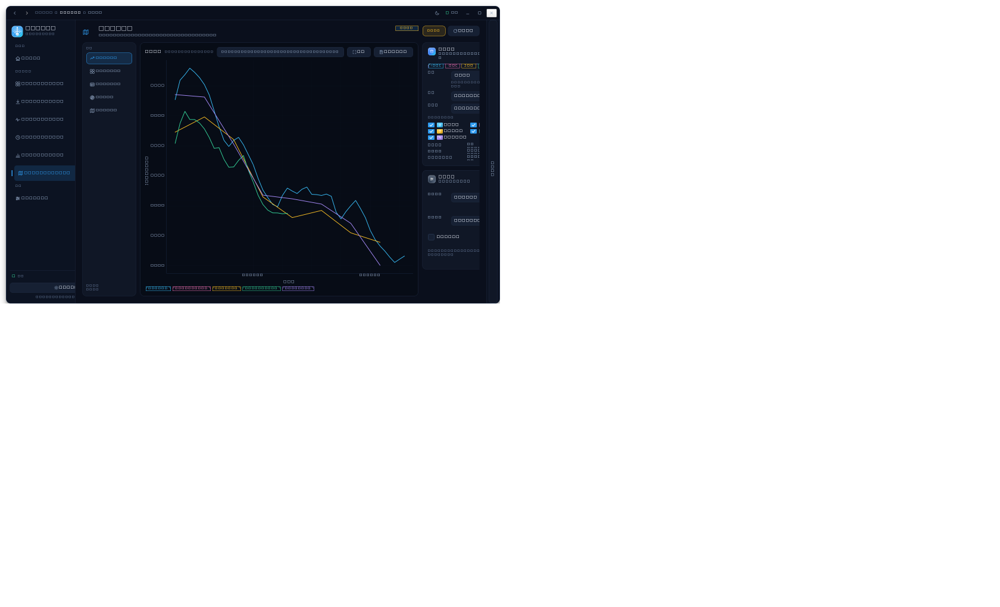

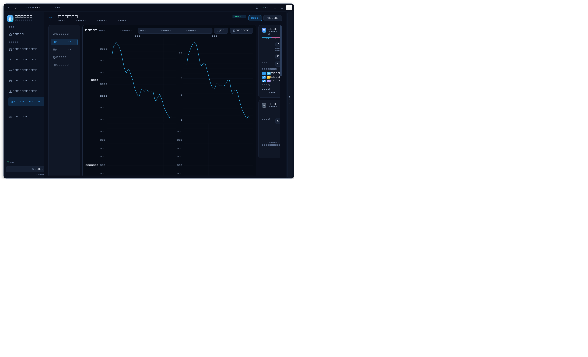

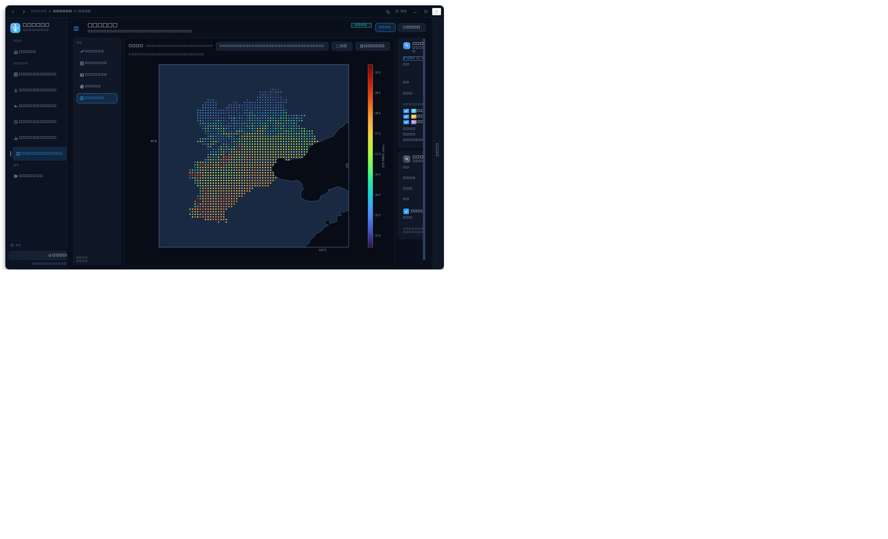

### 7.2 右侧参数区

- **数据源勾选**：五个数据源各一个带徽章的勾选项，可任意组合；图例与颜色映射保持同步。
- **站点**：下拉框列出全部测站，默认取首个站点，可搜索定位。
- **变量**：ZTD / PWV 等切换，曲线、分面、表格随之联动。
- **时段**：三选项——全部时段（各源自身覆盖）、公共时段、某单源覆盖时段；
  默认选中公共时段，标签与实际取值一致。
- **地图指标字段**：ZTD RMSE、ZTD Bias、PWV RMSE、PWV Bias、测站高程、
  ZTD 数值、PWV 数值，共 7 个可选字段，切换即重绘热度。

### 7.3 交互操作

| 操作 | 效果 |
| --- | --- |
| 滚轮 | 曲线按数值轴缩放，地图以光标为中心缩放 |
| 按住拖动 | 曲线平移；地图平移视图，越界自动回弹 |
| 双击 | 曲线复位到自适应范围；地图复位到全图 |
| 悬停 | 曲线显示十字游标与各源数值；地图显示最近站点名称与数值；表格显示单元格提示 |
| 单击地图站点 | 该站点的曲线视图联动定位 |
| 导出 | 曲线与地图导出 PNG，指标表导出 CSV |

### 7.4 指标口径（汇报要点）

界面在需要说明的地方直接标注了口径，避免把派生值当成实测值：

- `MAE*` 由 RMSE 与 Bias 推算：`MAE ≈ sqrt(2/π) · sqrt(RMSE² − Bias²)`，不额外引入实测；
- `相关性*` 为派生值：`1 − |Bias| / RMSE`；
- `空间分辨率(规格)` 取数据源声明的模式网格，五源均插值到同一套 GNSS 站网，
  站点间距实测相同，无法从产出中区分；
- 精度、偏差取全部站点的中位数，采样间隔取相邻产出时刻的中位间隔，
  站点覆盖 = 有效站点 ÷ 站网规模。

---

## 8. 数据来源自动判定

界面启动时扫描工程目录，自动决定展示哪一套数据，并在两处给出明确标识
（顶部胶囊标签与左侧导航底部信息）：

| 判定结果 | 触发条件 | 界面标识 |
| --- | --- | --- |
| 演示数据 | 仅存在仓库自带的基准结果 | 胶囊显示「演示数据」 |
| 我的结果 | 存在自己跑出来的输出目录 | 胶囊显示「我的结果」，并列出结果目录路径 |

数据来源与时间覆盖、站点 / 时次数量一起显示在右侧信息区，
点击「重新扫描」可随时重新识别，无需重启程序。

---

## 9. 实测与验收

### 9.1 测试环境

| 项目 | 值 |
| --- | --- |
| 操作系统 | Windows 11（AMD64） |
| Python | 3.13.9（Anaconda） |
| 界面框架 | PySide6 6.9.2 |
| 图表引擎 | pyqtgraph 0.14.0 + matplotlib 3.10.6 |
| 地图依赖 | cartopy 0.25.0、geopandas 1.1.4、shapely 2.1.2 |
| 其他 | cfgrib 0.9.15.1、cdsapi、xarray、netCDF4、h5py、joblib 均已就位 |

### 9.2 测试项与结果

| 测试项 | 方法 | 结果 |
| --- | --- | --- |
| 全页面渲染 | 8 个页面 × 深 / 浅双主题，2× 分辨率（3360×2040 px）逐页截图 | 27 张截图，0 空白页，0 报错 |
| 交互回归 | 逐页导航、五视图切换、主题切换、抽屉开合、数据源勾选、变量与时段切换、重新扫描 | 24 步，0 异常 |
| 真实桌面启动 | 在桌面环境实际启动主窗口并保持运行 | 进程存活、窗口标题正常、标准输出与错误输出均为空 |
| 启动与渲染耗时 | 计时 | 启动到主窗口显示约 4.2 s；地图首帧约 0.2 s；视图切换约 0.4 s |
| 真实链路 | 指向自备的 `output_ERA5` 结果目录后重新扫描 | 来源判定为「我的结果」，信息区显示结果目录、`1443 站 · 48 时次`，四个视图全部正常渲染 |
| 边界：无数据 | 空目录启动 | 胶囊显示「0 源 · -」，地图给出「当前数据源缺少可用的站点数据」提示，不崩溃 |
| 边界：单数据源 | 仅放 ERA5 一份结果 | 时段下拉正确列出该源覆盖区间，地图与曲线正常 |
| 边界：时间窗 | 全部时段 / 公共时段 / 空时段 | 均正常渲染，无异常 |
| 边界：超长站名 | 62 字符站点名 | 文字不越界、不截断布局 |
| 边界：高 DPI | 5120×2880 逻辑分辨率（4K 缩放） | 实际输出 7680×4320 px，图标与线条依然锐利 |

边界场景（无数据 / 单源 / 超长站名）：

| 无数据 | 单数据源 |
| --- | --- |
| 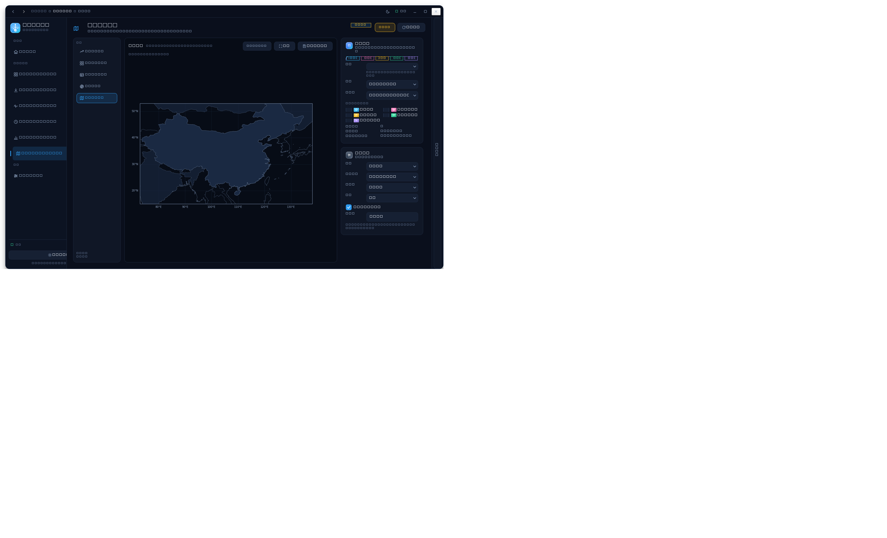 | 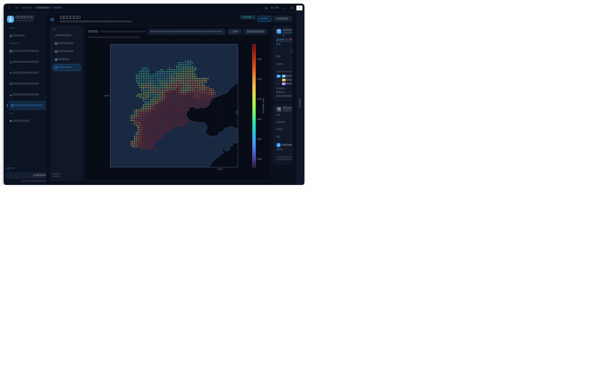 |

| 超长站名 | 4K 高 DPI |
| --- | --- |
| 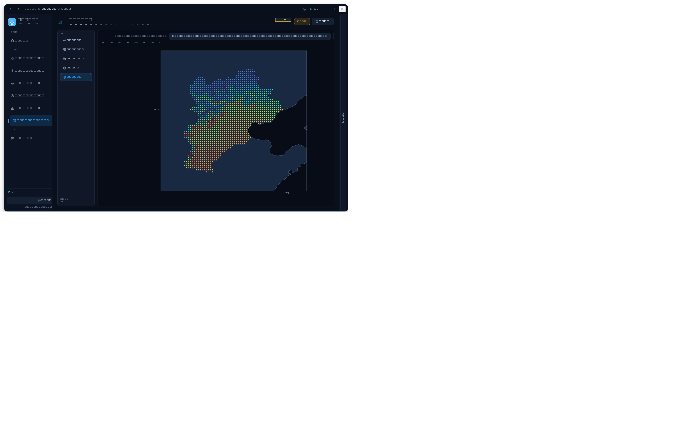 | 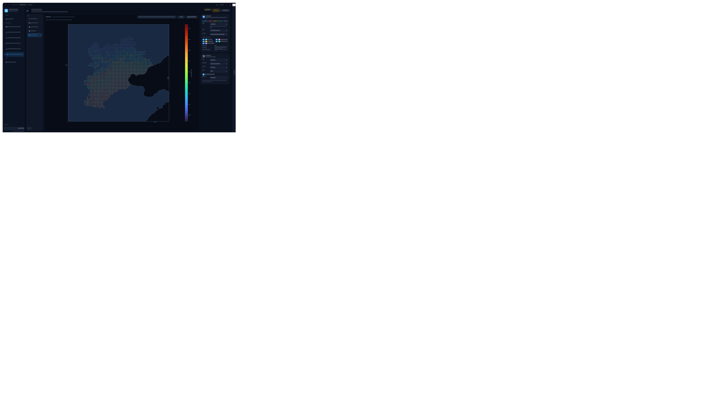 |

### 9.3 本轮修复的缺陷

测试过程中发现并修复了 3 个真实缺陷（均在 `metcom/gui/` 内，业务代码未改动）：

| 位置 | 现象 | 修复 |
| --- | --- | --- |
| `pages/download.py` | 开始 / 结束时间为空时，时长换算抛异常，导致整个界面无法启动 | 空值直接返回 0，界面显示「—」 |
| `data.py` | 只有时间序列产出的结果目录，时间覆盖只显示单个时刻 | 新增时间窗刷新逻辑，按全部产出文件名求真实区间 |
| `pages/visualize.py` | 时段下拉默认选中「公共时段」，标签却显示「全部时段」 | 初始选中项与默认取值对齐 |

---

## 10. 当前环境下的注意事项

以下问题均为**数据与凭据准备问题**，界面本身未发现缺陷。
界面会在对应页面点「运行」前把这些问题以红字列在参数卡下方，不会静默失败。

| 序号 | 现象（界面实际提示） | 影响 | 处理方式 |
| --- | --- | --- | --- |
| 1 | 格点生成：DEM 全球地形不存在 `..\METCOM_ver3.1\01_MakeGrdText\lib\earth_relief_03m.nc`；行政区划 shapefile 不存在；DEM 输入不存在 | 第 01 步无法运行 | 把原 MATLAB 包放在工程同级目录，或改配置为实际路径 |
| 2 | 数据下载：CDS API 密钥不存在 `CDSAPI\.cdsapirc_test` | 第 02 步无法运行 | 按手册申请并放置 CDS 密钥文件（项目内或用户级均可） |
| 3 | 核心反演：再分析数据根目录不存在 `E:\ERA5_Download\era5_Data` | 第 03 步无法运行 | 挂载数据盘或改配置指向实际数据 |
| 4 | 核心反演：未定位到 ERA5 的 EGM2008 文件 `geoidheight_EGM2008_0250.mat` | 第 03 步无法计算 | 提供 5 个 EGM2008 文件，或在参数中显式指定 `egm_file` |
| 5 | 反演：站点列表 `bth_0125_orthometric.txt` 报不存在 | 校验误报（文件实际在 `benchmarks/` 下） | 配置改指向 `benchmarks/bth_0125_orthometric.txt` |
| 6 | 时间插值：输入目录 `output_Merra2` 不存在 | 第 04 步无法运行 | 配置改指向 `benchmarks/output_Merra2` 或自备结果 |
| 7 | 精度评估：数据源 A / B 目录不存在 | 第 05 步评估无法运行 | 改配置指向实际的两套结果目录 |
| 8 | 可视化绘图：输入评估 txt 不存在 | 命令行版绘图无法运行 | 改配置指向实际评估结果；界面版可视化不受影响 |

由此带来的直接后果：

> 目前的「一键流水线」会在第 01 步就被前置校验拦下并提示原因；
> 演示数据只覆盖第 05 步的图形化展示环节，因此现在能看到的完整效果集中在可视化工作台。
> 上述 1–8 项补齐后，01→05 可全链路贯通。

两点补充说明：

- 环境自检页在**纯命令行环境**下运行时会显示「字体：未创建 QApplication」一条警告，
  这是自检脚本本身脱离界面运行所致；正常启动图形界面后该项为正常状态，不影响使用。
- 项目根目录已确认不存在 `tmp_patch_probe*.txt` 等调试残留文件。

---

## 11. 运行方式

在工程根目录执行：

```
python -m metcom.gui
```

可选参数：

- `--dark` / `--light`：启动时直接指定深色或浅色主题（不带参数则默认深色）；
- 安装为包之后，也可用控制台命令 `metcom-gui` 启动，两者等价。

---

## 12. 后续计划

- 补齐外部数据与凭据后，做一次 01→05 全链路贯通测试，并录制流程演示。
- 打包为免安装的可执行程序，便于在无 Python 环境的机器上分发。
- 按需补充结果导出（批量出图、报告式汇总）与多语言支持。

---

## 附录 A　截图索引

全部截图位于 `docs/gui-shots/`，命名规则为「页面-主题」：

| 文件名 | 内容 |
| --- | --- |
| `00-splash-dark.png` | 启动画面 |
| `home-dark.png` / `home-light.png` | 工作台首页（深 / 浅） |
| `visualize-dark.png` / `visualize-light.png` | 可视化工作台（深 / 浅） |
| `visualize-drawer-dark.png` | 日志抽屉展开 |
| `visualize-max-dark.png` | 窗口最大化 |
| `gridgen-dark.png` 等 | 01 格点生成 / 02 数据下载 / 03 核心反演 / 04 时间插值 / 05 精度评估 / 环境与设置 |
| `real-visualize-overlay-dark.png` 等 | 指向自备结果后的「我的结果」状态（叠加曲线 / 分面 / 地图） |
| `edge-nodata-*.png` | 无数据边界 |
| `edge-singlesource-visualize-dark.png` | 单数据源边界 |
| `edge-alltime-visualize-dark.png` | 全部时段边界 |
| `edge-longname-visualize-dark.png` | 62 字符超长站名 |
| `edge-4k-visualize-dark.png` | 4K / 高 DPI（7680×4320 px） |
